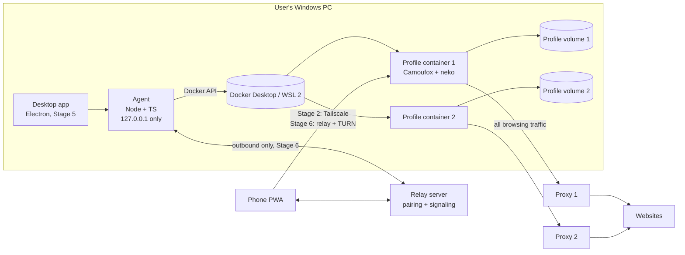

# Architecture

## One sentence

Profiles run as Docker containers on the user's Windows PC; a local agent manages them; the PC app and the phone both act as screens that stream the running browser.

## Diagram

## Components

### Browser image (`images/browser/`)
A Docker image based on neko v3's base image with Camoufox installed as the browser. neko provides the virtual display, audio, input handling and WebRTC streaming to any modern browser. Camoufox provides engine level fingerprint control. One image, many containers.

### Profile container
One container per running profile. Mounts the profile's volume (browser data directory and `profile.json`). Receives proxy settings and fingerprint through mounted config, never baked into the image. Network egress is locked so only the proxy host is reachable (fail closed).

### Agent (`packages/agent/`)
Node.js + TypeScript service running on the Windows host. It is the brain:
- creates, starts, stops and deletes profiles through the Docker Engine API
- generates fingerprints at profile creation (by running a one off container with the fingerprint generator, so Python stays inside the image)
- checks proxies before start (the "safety check")
- assigns ports and passwords for each profile's stream
- stops idle profiles
- exposes a local HTTP API on 127.0.0.1 with token auth (`specs/agent-api.md`)
- from Stage 6, keeps an outbound connection to the relay for phone access

In Stages 1 to 4 the agent runs from the command line. In Stage 5 it is embedded in the desktop app's main process.

### Desktop app (`packages/desktop/`, Stage 5)
Electron + React. Talks to the agent. Shows the profile list, create wizard, settings, setup checker, and an embedded viewer for each profile's stream.

### Phone client (`packages/mobile/`)
A PWA. Stage 2: just the neko web client over Tailscale. Stage 4: adds camera and mic upstream. Stage 6: adds pairing, profile list, and connection through the relay.

### Relay (`packages/relay/`, Stage 6)
Small Node service deployed to the cloud (Railway, Fly.io or a VPS). Handles device pairing, authentication, and tunnels signaling between phone and agent. Plus a TURN server (coturn) for media when a direct connection fails. **Never stores or sees browsing data.** Media is end to end between phone and PC whenever possible, and encrypted (DTLS-SRTP) when relayed through TURN.

## Key flows

### Create profile
1. User enters name, proxy, and optional device template.
2. Agent checks the proxy: reachable, exit IP, IP geolocation.
3. Agent runs the generator container with OS = Windows and the proxy's country, timezone, locale.
4. Agent saves `profile.json` (schema in `specs/profile-schema.md`) and creates the volume.

### Start profile
1. Agent rechecks the proxy (safety check). Abort if it fails.
2. Agent starts the container with: volume, fingerprint config, proxy, egress lock, stream password, assigned ports.
3. Agent waits until the stream is healthy, then reports the stream URL.

### Continue on phone
1. Phone opens the profile's stream (Stage 2 via Tailscale address, Stage 6 via relay).
2. Phone gets the same live browser. PC viewer can stay open; both are viewers of one browser.

### Camera on phone (Stage 4)
1. A page in the profile calls `getUserMedia`.
2. The phone client is asked to share its camera; user confirms on the phone.
3. Phone streams camera and mic over WebRTC to the profile container, where they are delivered to the browser as its camera and microphone.

### Idle stop
After N minutes with no viewer and no media activity (configurable), the agent stops the container. Data persists on the volume. Next start restores the session (Camoufox session restore).

## Why this design

- **Cost:** the user's PC does all compute. Our servers only pair devices and relay signaling.
- **Continuity:** the browser never moves, so nothing has to sync and nothing can desync.
- **Consistency:** one fingerprint, one IP, one browser instance per profile.

## Known trade offs

- PC must be on with Docker running for phone access. A cloud mode is a later option.
- Docker Desktop and WSL setup is friction for users. Stage 7 addresses it.
- Containers are Linux pretending to be Windows. Stage 3 handles the consistency work.
